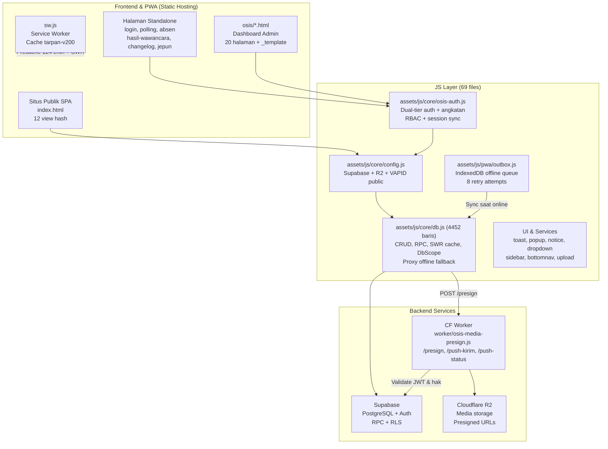
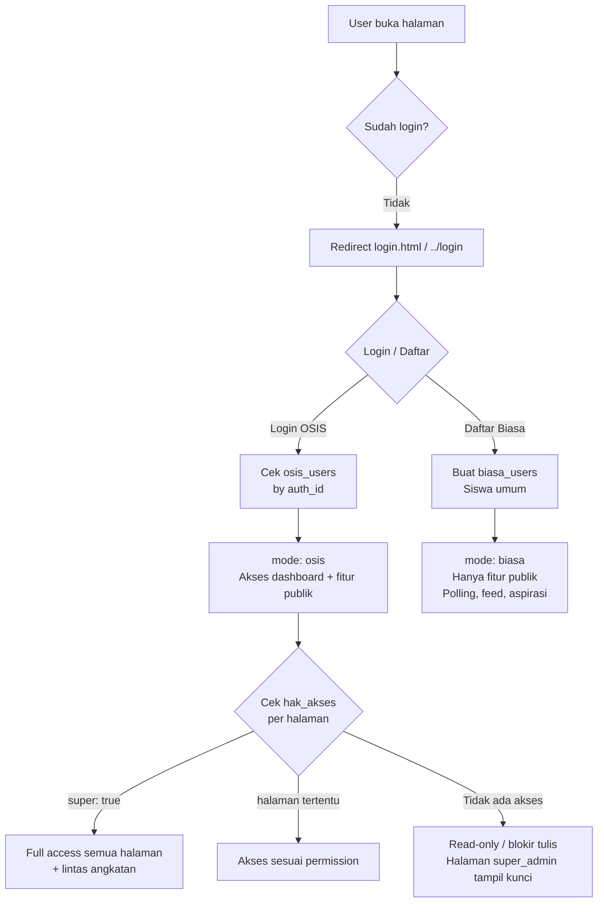
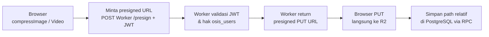
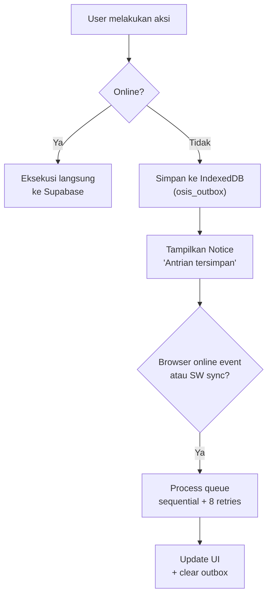

# 🏫 Analisis Lengkap: OSIS TARPAN ONE

> Sistem manajemen organisasi OSIS SMK Taruna Harapan 1 Cipatat — full-stack vanilla JS + Supabase + Cloudflare R2

**Domain:** `osistarpanone.my.id`
**Versi terakhir (DB `changelog`):** v8.3.2 (2026-10-18) — 73 rilis tercatat di tabel `changelog`

---

## Ringkasan Umum

**OSIS TARPAN ONE** adalah aplikasi web untuk mengelola seluruh kegiatan organisasi OSIS sekolah. Dibangun **tanpa framework & tanpa build step** (vanilla HTML/CSS/JS) dengan **69 file JavaScript** (`66` modul/aplikasi + `3` vendor) dan **23 file CSS**, menggunakan **Supabase** sebagai backend, **Cloudflare R2** untuk media via **Cloudflare Worker**, serta **Service Worker + IndexedDB outbox** untuk dukungan PWA & offline-first.

> [!IMPORTANT]
> Proyek ini memiliki **dua sisi** dengan arsitektur berbeda:
> - **Situs Publik** → SPA hash-router di `index.html` (`12 view`: `home`, `pengurus`, `sekbid`, `galeri`, `feed`, `arsip`, `pelantikan`, `aspirasi`, `kontak`, `musik`, `informasi`, `pengaturan`) + halaman standalone (`login.html`, `polling.html`, `absen.html`, `hasil-wawancara.html`, `changelog.html`, `jepun.html`, `offline.html`).
> - **Dashboard OSIS** → MPA di `osis/` (`20` halaman aktif + `_template.html`), dilindungi autentikasi & RBAC.

---

## Arsitektur Sistem



---

## Tech Stack

| Layer | Teknologi |
|---|---|
| **Frontend** | Vanilla HTML/CSS/JS (69 file JS: 66 modul + 3 vendor; 23 file CSS, tanpa framework/bundler) |
| **Design** | Neo-Brutalism — border tebal, hard shadow (`5px 5px 0`), radius `22px` |
| **Font** | Google Fonts — Outfit (400–900) |
| **Icons** | Font Awesome 6.5 |
| **Backend DB** | Supabase PostgreSQL (60+ tabel `public`, RPC `SECURITY DEFINER`, RLS + isolasi angkatan) |
| **Auth** | Supabase Auth (mapping `auth_id` ke `osis_users` / `biasa_users`) |
| **Media** | Cloudflare R2 via Worker presigned URLs (SigV4 zero-dependency) |
| **Push** | Web Push murni (VAPID P-256) via Worker `/push-kirim` |
| **Hosting** | Static hosting (`osistarpanone.my.id`, GitHub Pages / Cloudflare Pages) |
| **PWA** | Service Worker (`tarpan-v200`, 124 entri `APP_SHELL`) + Web Manifest + IndexedDB outbox |
| **Offline** | Stale-While-Revalidate cache (`osis_cache_v3_*`) + IndexedDB mutation queue (`osis_outbox`) |

---

## Struktur File

```text
osistarpanone/
├── index.html              # Situs publik SPA (2636 baris, 12 view)
├── login.html              # Login + registrasi akun biasa
├── polling.html            # E-voting Waketos
├── absen.html              # Absen QR sisi siswa (scan sesi / kartu QR)
├── hasil-wawancara.html    # Pengumuman hasil wawancara (publik)
├── changelog.html          # Riwayat versi (DB-driven)
├── jepun.html              # Quiz huruf Jepang (standalone)
├── offline.html            # Fallback offline PWA
├── sw.js                   # Service Worker (347 baris, tarpan-v200)
├── manifest.webmanifest    # PWA manifest + app shortcuts
├── robots.txt
├── sitemap.xml
├── CNAME                   # osistarpanone.my.id
├── serve.json
├── package.json            # Dependensi script CLI di scripts/
│
├── osis/                   # Dashboard OSIS (MPA, auth-gated, 21 file)
│   ├── _template.html
│   ├── index.html
│   ├── profil.html
│   ├── users.html
│   ├── akses.html
│   ├── logs.html
│   ├── anggota.html
│   ├── absensi.html
│   ├── agenda.html
│   ├── program-tahunan.html
│   ├── program-bulanan.html
│   ├── dokumen.html
│   ├── notulensi.html
│   ├── informasi.html
│   ├── poster.html
│   ├── notifikasi.html
│   ├── keuangan.html
│   ├── uang-kas.html
│   ├── tabungan.html
│   ├── wawancara.html
│   └── hasil-wawancara.html
│
├── assets/
│   ├── css/
│   │   ├── shared/         # style.css (8039 baris), osis2.css (660 baris)
│   │   ├── public/         # feed.css, hasil-wawancara.css, jepun.css
│   │   └── osis/           # 18 CSS modul dashboard
│   ├── js/
│   │   ├── core/           # config.js, db.js, app.js, osis-auth.js, login.js
│   │   ├── shared/
│   │   │   ├── ui/         # toast, notice, show-popup, dropdown, context-menu, bottomnav, nav-atur
│   │   │   └── utilities/  # form-persist, site-edit, pengaturan
│   │   ├── services/       # upload, compress-video, visitor, aktivitas
│   │   ├── pwa/            # pwa, outbox, push
│   │   ├── public/         # 16 modul situs publik & standalone
│   │   ├── osis/
│   │   │   ├── shell/      # osis-sidebar, osis-header, osis-visitor, dashboard
│   │   │   └── modules/    # 18 modul halaman dashboard OSIS
│   │   ├── features/       # evaluasi, formulir, form-publik, osis-menu, proker, task
│   │   └── vendor/         # supabase.min.js, jsQR.min.js, qrcode.min.js
│   ├── icons/              # favicon-32, apple-touch-icon, icon-192, icon-512, icon-512-maskable
│   ├── images/             # logo.png, logo.jpeg
│   └── fonts/              # (kosong, cadangan font lokal)
│
├── database/
│   └── migrations/         # 20 file migrasi SQL Supabase
│
├── worker/                 # Cloudflare Worker (722 baris)
│   ├── osis-media-presign.js  # R2 presign + SigV4 + /push-kirim + /push-status
│   ├── wrangler.toml
│   └── .dev.vars.example
│
└── scripts/                # Script admin (Node.js)
    ├── migrasi-auth-bulk.mjs
    ├── reset-password.mjs
    ├── migrate-supabase-to-r2.mjs
    ├── backfill-thumb.mjs
    └── gen-vapid.cjs
```

---

## Sistem Autentikasi & Otorisasi

### Dual-Tier Account Architecture



| Aspek | Detail |
|---|---|
| **Akun OSIS** | Pengurus OSIS → tabel `osis_users` → email sintetis (`<nama>@osistarpanone.my.id` atau fallback `osis-<id>@osistarpanone.my.id`) |
| **Akun Biasa** | Siswa umum → tabel `biasa_users` → email sintetis `biasa-<id>@osistarpanone.my.id` (tanpa hak dashboard OSIS) |
| **Session** | Supabase Auth JWT + localStorage cache (`osis_user`, `osis_akses`, `osis_angkatan_aktif`, `osis_angkatan_list`) |
| **Sync** | `OsisAuth.syncAuth()` — validasi session Auth di background, buang cache jika session hilang atau guest legacy |
| **RBAC** | `OsisAuth.bisa(halaman)` & `OsisAuth.isSuper()` — cek `super`, `"*"`, atau daftar halaman |
| **Guard** | `OsisAuth.butuh(halaman)` — return `false` + toast error jika tidak punya hak tulis |
| **Isolasi Angkatan** | `OsisAuth.isLintasAngkatan()` & `OsisAuth.getAngkatanAktif()` — scope data internal per angkatan |

### Hak Akses (tersimpan di tabel `osis_akses` via RPC `akses_saya`)
```javascript
{
  halaman: ["anggota", "keuangan", "agenda", ...],
  sekbid_id: 3,
  sekbid_nama: "Sekbid 3 (Bela Negara)",
  super: false,
  angkatan_id: 4,
  angkatan: "2025/2026",
  lintas_angkatan: false
}
```

---

## Database Layer (`assets/js/core/db.js` — 4.452 baris)

### Fitur Utama

| Fitur | Implementasi |
|---|---|
| **CRUD & RPC** | Wrapper Supabase RPC & query untuk seluruh modul (termasuk `DbScope` isolasi angkatan) |
| **SWR Cache** | `Cache` (`version: "v3"`, `prefix: "osis_cache_"`) → `osis_cache_v3_<key>` / `osis_cache_v3_ang_<id>_<key>` di `localStorage` |
| **Offline Proxy** | `fetchDenganTimeout()` (timeout 6 detik, reject saat offline) + `supa` fallback `Proxy` bila CDN belum termuat |
| **Image Compression** | `compressImage()` — resize canvas ≤1920px, turunkan quality dari `0.85` (step `-0.12`, batas `>0.42`) hingga ≤0.95MB (+ rescale `0.75x` jika masih besar) |
| **Thumbnail Auto** | `buatThumb()` + `unggahThumbR2()` — buat versi `-thumb.jpg` (400px, quality 0.68) otomatis saat upload |
| **Video Compression** | `pastikanCompressVideo()` — lazy-load `assets/js/services/compress-video.js` saat diperlukan |
| **Presigned Upload** | `r2MintaPresign("put" \| "delete", path, contentType)` → Worker `/presign` → PUT/DELETE langsung ke R2 |
| **Device Fingerprint** | `getDeviceId()` — dual-store `localStorage` (`osis_did` / `osis_device_id`) + cookie (2 tahun) |
| **Server Auth** | Setiap RPC mengirim `p_user_id` — PostgreSQL memverifikasi identitas (`auth.uid()`) & hak akses |

### Alur Upload Media


---

## Semua Modul & Fitur (69 JS Files)

### 🔐 Dashboard OSIS (`assets/js/osis/`)

#### Shell (`assets/js/osis/shell/` — 4 file)
| Modul | File | Baris | Deskripsi |
|---|---|---:|---|
| **Sidebar** | `osis-sidebar.js` | 1.517 | Drawer navigasi kiri + grup + mode editor (DB-backed di `site_content`) |
| **Header** | `osis-header.js` | 576 | Header admin, menu overflow titik-tiga, sinkronisasi paritas menu publik |
| **OSIS Visitor** | `osis-visitor.js` | 342 | Tracking kunjungan dashboard khusus pengurus (`osis_visitor`) |
| **Dashboard** | `dashboard.js` | 786 | Command center bento grid, ringkasan kas/absensi/agenda/aspirasi/lagu |

#### Modules (`assets/js/osis/modules/` — 18 file)
| Modul | File | Baris | Deskripsi |
|---|---|---:|---|
| **Absensi** | `absensi.js` | 2.053 | Absensi pengurus (izin/sakit/alpha/hadir), statistik & rekap per tanggal |
| **Absensi QR** | `absensi-qr.js` | 574 | Operator QR absensi di `osis/absensi.html` (QR sesi & scan kartu QR) |
| **Agenda** | `agenda.js` | 1.171 | Kalender, timeline, filter sekbid & pengunggah, upload foto drag-and-drop |
| **Akses** | `akses.js` | 340 | Matriks hak akses user × halaman + sekbid pemilik (khusus `super_admin`) |
| **Anggota** | `anggota.js` | 305 | CRUD daftar anggota per angkatan (sumber roster absensi) |
| **Dokumen** | `dokumen.js` | 810 | Arsip dokumen digital (upload, cari, filter, preview PDF/gambar) |
| **Informasi** | `informasi.js` | 435 | Broadcast pengumuman internal pengurus (shareable via `?id=`) |
| **Keuangan** | `keuangan.js` | 1.390 | Kas masuk/keluar OSIS, saldo, bukti transaksi R2 (`kas/`), cetak laporan |
| **Logs** | `logs.js` | 268 | Monitoring aktivitas real-time & presence online (khusus `super_admin`) |
| **Notifikasi** | `notifikasi.js` | 236 | Kirim Web Push manual & uji notif lokal (khusus `super_admin`) |
| **Notulensi** | `notulensi.js` | 790 | Notulensi rapat, lampiran, tampilan artikel & cetak/PDF |
| **Akun OSIS** | `osis-users.js` | 607 | CRUD akun `osis_users` & reset password awal (khusus `super_admin`) |
| **Poster** | `poster.js` | 336 | Feed poster peringatan + lightbox |
| **Profil** | `profil.js` | 347 | Profil pribadi, ganti nama/username/password, foto profil (`profil/`) |
| **Program** | `program.js` | 514 | Program kerja tahunan & bulanan per sekbid |
| **Tabungan** | `tabungan.js` | 1.118 | Catat setoran tabungan per anggota, running total & verifikasi ceklis |
| **Uang Kas** | `uang-kas.js` | 1.369 | Iuran kas mingguan FIFO per anggota, tarif fleksibel & minggu libur |
| **Wawancara** | `wawancara.js` | 2.899 | Sesi wawancara calon OSIS, multi-pewawancara, progres jawaban & dokumentasi |

### 🌐 Situs Publik & Standalone (`assets/js/public/` — 16 file)

| Modul | File | Baris | Deskripsi |
|---|---|---:|---|
| **Home** | `home.js` | 718 | Beranda, jejak sejarah angkatan, bento slider, ticker |
| **Pengurus** | `pengurus.js` | 881 | Direktori kepemimpinan (ketua, wakil, pengurus) |
| **Sekbid** | `sekbid.js` | 118 | Kartu BPH & seksi bidang dari database |
| **Galeri** | `galeri.js` | 595 | Dokumentasi kegiatan grid bento + inline edit untuk pengurus |
| **Feed** | `feed.js` | 980 | Social feed foto/video ala IG (like, komentar, share, paginasi) |
| **Arsip** | `arsip.js` | 1.385 | Arsip seluruh dokumentasi kegiatan dengan paginasi server-side |
| **Aspirasi** | `aspirasi.js` | 587 | Form kirim aspirasi siswa & sakelar buka/tutup |
| **Lagu** | `lagu.js` | 608 | Request lagu radio jam istirahat + antrian playlist |
| **Info Publik** | `informasi-view.js` | 920 | Pengumuman publik (`#/informasi`), detail modal, kelola untuk hak `informasi` |
| **Prestasi** | `prestasi.js` | 479 | Showcase prestasi siswa dari database |
| **Kegiatan** | `kegiatan.js` | 753 | Bento cards kegiatan dari database |
| **Polling** | `polling.js` | 529 | E-voting Waketos (`polling.html`), 1-akun-1-suara, hasil live |
| **Absen Siswa** | `absen-siswa.js` | 387 | Halaman `absen.html` — absen QR sisi siswa (scan sesi / kartu digital) |
| **Changelog** | `changelog.js` | 386 | Halaman `changelog.html` — riwayat rilis DB-driven + inline editor |
| **Jepun** | `jepun.js` | 326 | Halaman `jepun.html` — kuis tebak huruf Hiragana/Katakana |
| **Hasil Wawancara** | `hasil-wawancara.js` | 881 | Dipakai di `hasil-wawancara.html` (publik) & `osis/hasil-wawancara.html` (internal) |

### ⚙️ Core, Shared, Services, PWA, Features & Vendor (31 file)

| Kategori | File | Baris | Deskripsi |
|---|---|---:|---|
| **Core** | `assets/js/core/config.js` | 25 | Konfigurasi Supabase, R2, Worker URL, domain auth, VAPID public key |
| **Core** | `assets/js/core/db.js` | 4.452 | Layer DB (RPC, SWR cache `v3`, `DbScope`, kompresi gambar/thumb, presign R2) |
| **Core** | `assets/js/core/app.js` | 582 | SPA `Router` (12 view), `FotoWeb`, helper umum & format mata uang |
| **Core** | `assets/js/core/osis-auth.js` | 397 | Dual-tier auth (`osis`/`biasa`), RBAC, `syncAuth`, isolasi angkatan |
| **Core** | `assets/js/core/login.js` | 446 | Halaman login gabungan + registrasi akun biasa |
| **Shared UI** | `assets/js/shared/ui/toast.js` | 49 | Notifikasi toast bawah neo-brutalist |
| **Shared UI** | `assets/js/shared/ui/notice.js` | 192 | Pill status persisten kanan atas (offline, edit mode, antrean) |
| **Shared UI** | `assets/js/shared/ui/show-popup.js` | 808 | Sistem modal universal (`info`/`success`/`error`/`confirm`/`form`) + stack back-button |
| **Shared UI** | `assets/js/shared/ui/dropdown.js` | 435 | Komponen dropdown custom pengganti `<select>` bawaan |
| **Shared UI** | `assets/js/shared/ui/context-menu.js` | 326 | Menu konteks klik kanan / tekan tahan global (dimuat dinamis oleh `pwa.js`) |
| **Shared UI** | `assets/js/shared/ui/bottomnav.js` | 307 | Bottom navigation bar & sheet "Menu Lainnya" (DB-backed) |
| **Shared UI** | `assets/js/shared/ui/nav-atur.js` | 501 | Editor visual navigasi bawah & menu sheet (khusus `super_admin` / hak `Site`) |
| **Utilities** | `assets/js/shared/utilities/form-persist.js` | 147 | Auto-save draft form `/osis/*` ke `localStorage` |
| **Utilities** | `assets/js/shared/utilities/site-edit.js` | 1.151 | Editor teks & foto inline untuk pengurus OSIS |
| **Utilities** | `assets/js/shared/utilities/pengaturan.js` | 598 | Halaman `#/pengaturan` (preferensi per perangkat, kompresi video, cache, notif) |
| **Services** | `assets/js/services/upload.js` | 648 | Background upload manager dengan progres persen via XHR |
| **Services** | `assets/js/services/compress-video.js` | 816 | Kompresi video hybrid (MediaRecorder native HP / ffmpeg.wasm desktop) |
| **Services** | `assets/js/services/visitor.js` | 475 | Tracking pengunjung unik harian (zona `Asia/Jakarta`) & popup statistik |
| **Services** | `assets/js/services/aktivitas.js` | 139 | Logger buka halaman, aksi user & presence heartbeat (60 detik) |
| **PWA** | `assets/js/pwa/pwa.js` | 314 | Registrasi SW, install prompt, + dynamic loader `outbox.js`, `push.js`, `context-menu.js` |
| **PWA** | `assets/js/pwa/outbox.js` | 1.417 | Antrean mutasi offline di IndexedDB (`osis_outbox`) + auto-sync (`MAX_TRIES = 8`) |
| **PWA** | `assets/js/pwa/push.js` | 884 | Subscribe/unsubscribe Web Push VAPID per perangkat |
| **Features** | `assets/js/features/evaluasi.js` | 775 | Modul evaluasi kegiatan *(belum terpasang di HTML aktif, masih di precache SW)* |
| **Features** | `assets/js/features/formulir.js` | 1.143 | Form builder *(belum terpasang di HTML aktif, masih di precache SW)* |
| **Features** | `assets/js/features/form-publik.js` | 307 | Engine form publik *(belum terpasang di HTML aktif, masih di precache SW)* |
| **Features** | `assets/js/features/osis-menu.js` | 53 | Nav pill admin legacy *(digantikan `osis-sidebar.js`/`osis-header.js`, masih di precache SW)* |
| **Features** | `assets/js/features/proker.js` | 694 | Modul proker *(belum terpasang di HTML aktif, masih di precache SW)* |
| **Features** | `assets/js/features/task.js` | 519 | Kanban task board *(hanya direferensikan di `_template.html` & precache SW)* |
| **Vendor** | `assets/js/vendor/supabase.min.js` | 17 | Supabase JS client (minified, jangan diedit) |
| **Vendor** | `assets/js/vendor/jsQR.min.js` | 8 | Library decoder QR kamera (`osis/absensi.html`) |
| **Vendor** | `assets/js/vendor/qrcode.min.js` | 1 | Library generator QR (`absen.html` & `osis/absensi.html`) |

**Total: `47.916` baris kode JavaScript non-vendor** (`66` file, tidak termasuk `3` file vendor minified).

---

## Database (Supabase PostgreSQL)

Seluruh file migrasi terlacak di `database/migrations/` (`20` file SQL). Tabel aktif di schema `public`:

| Domain | Tabel Utama (`public`) |
|---|---|
| **Auth, RBAC & Angkatan** | `osis_users`, `biasa_users`, `osis_akses`, `jabatan_akses`, `osis_super_admins`, `angkatan`, `periode` |
| **Pengurus & Anggota** | `pimpinan`, `pengurus`, `sekbid`, `anggota`, `pelantikan`, `pelantikan_minta` |
| **Absensi & QR** | `osis_absensi`, `osis_absensi_config`, `osis_absensi_qr_rahasia`, `osis_absensi_qr_sesi`, `osis_absensi_qr_kartu` |
| **Keuangan & Tabungan** | `osis_kas`, `osis_saldo_awal`, `osis_uang_kas_config`, `osis_uang_kas_setoran`, `osis_tabungan` |
| **Operasional OSIS** | `sekbid_agenda`, `program`, `osis_dokumen`, `rapat_notulensi`, `informasi`, `poster` |
| **Wawancara Calon OSIS** | `wawancara_calon`, `wawancara_pertanyaan`, `wawancara_sesi`, `wawancara_sesi_petugas`, `wawancara_jawaban`, `wawancara_urutan`, `wawancara_turunan`, `wawancara_dokumentasi` |
| **Konten & Fitur Publik** | `gallery`, `arsip`, `kegiatan`, `prestasi`, `feed_posts`, `feed_likes`, `feed_comments`, `informasi_publik`, `aspirasi`, `lagu_requests`, `polling_kandidat`, `polling_suara`, `changelog`, `web_foto`, `site_content`, `pengaturan` |
| **Monitoring & Push** | `visitor`, `osis_visitor`, `aktivitas`, `push_subscriptions` |

*(Tabel lain yang ada di DB: `moments`, `pesenan_orders`, `pesenan_order_items`, `wa_archives`, `wa_messages`, serta tabel internal `_backup_fungsi_auth_rpc_20261112`.)*

---

## Cloudflare Worker & R2

### Worker: `worker/osis-media-presign.js` (722 baris)
- **Zero-dependency SigV4** — AWS Signature v4 murni memakai Web Crypto API.
- **JWT & RBAC validation** — verifikasi token Supabase Auth, cek tautan `osis_users`, dan cek hak kelola folder/modul.
- **Folder allowlist (`FOLDER_BOLEH`):** `gallery`, `web`, `angkatan`, `prestasi`, `kegiatan`, `agenda`, `profil`, `anggota`, `pengurus`, `sekbid`, `pimpinan`, `notulensi`, `proker`, `program`, `dokumen`, `kas`, `evaluasi`, `formulir`, `polling`, `poster`, `moments`, `feed`, `arsip`, `informasi`, `pelantikan`.
- **MIME allowlist (`CONTENT_BOLEH`):** `image/jpeg`, `image/png`, `image/webp`, `image/gif`, `application/pdf`, `video/mp4`, `video/webm`, `video/quicktime`, `video/x-m4v`, `audio/mpeg`, `audio/mp4`, `audio/webm`.

| Endpoint | Method | Fungsi |
|---|---|---|
| `/presign` | POST | Terbitkan presigned URL `PUT` atau `DELETE` langsung ke Cloudflare R2 |
| `/push-kirim` | POST | Kirim notifikasi Web Push (VAPID) ke subscriber target (`publik` / `osis` / `semua`) |
| `/push-status` | GET | Cek status konfigurasi VAPID Worker & jumlah subscriber |

> [!NOTE]
> Upload publik tanpa login hanya diizinkan pada `PUT` dengan pola path `formulir/f-<id>-<ts>.<ext>` (untuk responden form publik).

---

## Offline-First Architecture



| Komponen | Mekanisme |
|---|---|
| **Service Worker (`sw.js`)** | Cache `tarpan-v200`, precache `124` entri `APP_SHELL`, navigasi network-first, aset lokal SWR (`basiDulu`), API Supabase network-only |
| **Outbox (`assets/js/pwa/outbox.js`)** | IndexedDB `osis_outbox`, auto-sync saat event `online` + SW Background Sync (`osis-outbox`), `MAX_TRIES = 8` |
| **SWR Cache (`assets/js/core/db.js`)** | `osis_cache_v3_<key>` (dan `osis_cache_v3_ang_<id>_<key>`) di `localStorage`, tampilkan cache lalu revalidasi |
| **Supabase Proxy** | `fetchDenganTimeout()` + fallback `Proxy` saat CDN offline agar pembacaan cache tetap jalan |
| **Offline Fallback** | `offline.html` untuk navigasi tak tercache, SVG placeholder untuk gambar gagal saat offline |

---

## Design System (CSS Neo-Brutalism)

### CSS Variables (`assets/css/shared/style.css` — 8.039 baris)
```css
:root {
  --red: #e11d2e;        /* Primary merah */
  --red-dark: #b3121f;   /* Hover/active */
  --red-deep: #7f0d16;   /* Kontras gelap */
  --ink: #1a1314;        /* Teks & border */
  --paper: #fffdfa;      /* Canvas utama (warm off-white) */
  --paper-2: #f5efea;    /* Surface sekunder */
  --yellow: #ffd11a;     /* Aksen kuning */
  --green: #1a7f37;      /* Success */
  --green-bg: #e7f8ec;
  --white: #ffffff;
  --gray: #6f6668;       /* Teks muted */
  --line: #e8e0da;       /* Separator */
  --shadow: 0 14px 34px rgba(26, 19, 20, 0.14);
  --shadow-hard: 5px 5px 0 var(--ink);  /* Signature neo-brutalist */
  --radius: 22px;        /* Bento card radius */
}
```

### Struktur Stylesheet (23 file CSS)
- **Shared (`assets/css/shared/`):** `style.css` (design system utama, `8.039` baris) & `osis2.css` (shared layout dashboard `/osis/*`, `660` baris)
- **Publik (`assets/css/public/`):** `feed.css`, `hasil-wawancara.css`, `jepun.css`
- **Dashboard (`assets/css/osis/`):** 18 file CSS per halaman (`absensi.css`, `agenda.css`, `akses.css`, `anggota.css`, `dokumen.css`, `index.css`, `informasi.css`, `keuangan.css`, `logs.css`, `notifikasi.css`, `notulensi.css`, `poster.css`, `profil.css`, `program-bulanan.css`, `program-tahunan.css`, `tabungan.css`, `uang-kas.css`, `wawancara.css`)

### Karakteristik Visual
| Aspek | Detail |
|---|---|
| **Outline** | Border tebal 2.5–3px solid `var(--ink)` |
| **Shadow** | Hard offset shadow tanpa blur (`5px 5px 0`) |
| **Interaksi** | Hover: translate up-left + shadow expand; Active: translate down-right + shadow zero |
| **Typography** | Outfit font, weight 700–900, uppercase labels |
| **Layout** | Bento grid, `--radius: 22px` |
| **Responsive** | Mobile-first, safe-area insets, adaptive grid |

---

## Interaction Architecture

```text
┌─────────────────────────────────────────────────────────┐
│                      BROWSER CLIENT                      │
│                                                          │
│  [core/app.js] ←→ [Router] (12 SPA views)                │
│     ├→ [FotoWeb] (dynamic web asset replacement)         │
│     └→ [formatRupiah] (currency formatting)              │
│                                                          │
│  [UI Shell]                                              │
│     ├→ [osis/shell/osis-sidebar.js] (DB-backed drawer)   │
│     ├→ [osis/shell/osis-header.js] (responsive overflow) │
│     ├→ [shared/ui/bottomnav.js] (pill nav + sheet)       │
│     ├→ [shared/ui/show-popup.js] (modals + back stack)   │
│     ├→ [shared/ui/toast.js] (transient alerts)           │
│     ├→ [shared/ui/notice.js] (persistent status pills)   │
│     └→ [shared/ui/dropdown.js & context-menu.js]         │
│                                                          │
│  [Auth, Services & PWA]                                  │
│     ├→ [core/osis-auth.js] (dual-tier, RBAC, angkatan)   │
│     ├→ [services/aktivitas.js] (heartbeat 60s, logs)     │
│     ├→ [services/upload.js & compress-video.js]          │
│     ├→ [pwa/pwa.js, outbox.js, push.js] (SW + IDB + Push)│
│     ├→ [shared/utilities/form-persist.js] (draft form)   │
│     └→ [services/visitor.js] (device fingerprint)        │
│                                                          │
│  [Data Layer]                                            │
│     └→ [core/db.js] ←→ [Cache v3] (SWR localStorage)     │
│            ↓                    ↓                        │
│     Supabase RPC          Worker /presign -> R2 PUT      │
└─────────────────────────────────────────────────────────┘
```

---

## Tools Admin (Node.js CLI — `scripts/`)

| Script | Fungsi |
|---|---|
| `scripts/migrasi-auth-bulk.mjs` | Migrasi akun lama → Supabase Auth, generate email sintetis |
| `scripts/reset-password.mjs` | Reset password via Supabase Admin API |
| `scripts/migrate-supabase-to-r2.mjs` | Pindahkan media dari bucket lama Supabase Storage ke Cloudflare R2 |
| `scripts/backfill-thumb.mjs` | Generate thumbnail `-thumb.jpg` untuk foto lama di R2 |
| `scripts/gen-vapid.cjs` | Generate keypair VAPID P-256 untuk Web Push |
